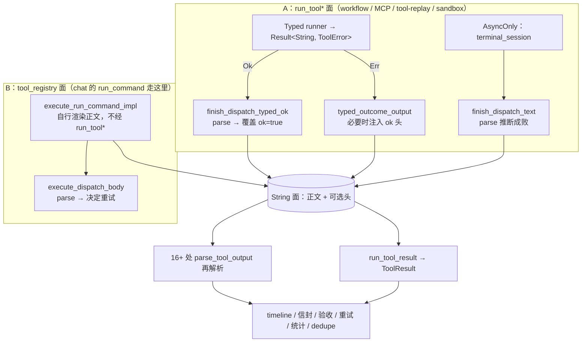

# 工具结果管线：用 `ToolOutcome` 消除「Typed → String → 启发式再解析」回环

> **状态：设计稿（issue #1143），尚未实现。** 落地按 §6 分四阶段，每阶段独立 PR、独立可回滚。
> 前置：`tool_runner_typed_migration.md`（Legacy → Typed 迁移）已完成，`ToolRunner` 只剩 `Typed` / `AsyncOnly`。
> 文中行号基于 `6876fe16` 之后的树；实现推进后行号会漂移，引用时以函数名为准。

---

## 1. 问题陈述

迁移完成后，**工具的成败已由类型表达**：`Typed` runner 返回 `Result<String, ToolError>`，失败是 `Err`，错误码在 `ToolError::code` 里。

但管线里还留着一次「编码 → 解码」往返：

- `run_tool` 的 String 面**丢掉** `ToolError`，必要时把失败**编码**进正文首行的 `crabmate_tool_output` 头（`ok` / `error_code`）；
- 下游 16+ 处再**解码**（`parse_tool_output`）把正文猜回 `ok` / `error_code` / `exit_code`。

于是同一个工具结果，成败有两条真相源。

### 症状 1：解析完立刻覆盖

`finish_dispatch_typed_ok`（`src/cm_tools/tools/mod.rs:512`）：

```rust
let mut parsed = parse_tool_output(name, &output);
parsed.ok = true;                                        // ← 已知成功，先猜一遍再否掉
parsed.error_code = None;
if parsed.exit_code.is_some_and(|code| code != 0) { parsed.exit_code = None; }
```

它真正需要的是 `exit_code` / `stdout` / `stderr` 三个**抽取**字段，却复用了「推断成败」的完整逻辑，然后作废结论。这行 `parsed.ok = true` 就是对「解析结果不可信」的自认。

### 症状 2：用线格式承载进程内状态

`typed_outcome_output`（`mod.rs:486`）在「正文启发式与真实成败不一致」时，往正文插 `crabmate_tool_output` 头。这个头本来是 Client 可见的**线格式**，现在兼作进程内的 out-of-band 通道。

### 症状 3：同一个结果，各处可能得出不同的 `ok`

| 消费点 | 需要的字段 | 当前取法 | 差异 |
|---|---|---|---|
| timeline `tool_step_finished`（`emit.rs:127`） | `ok`/`exit_code` | `parse_tool_output` | — |
| 模型信封 `encode_tool_message_envelope_v1`（`emit.rs:225`、`turn_completion.rs:171`） | `ok`/`code`/分类/可重试 | 同上 | — |
| 观测 `tool_stats`（`tool_stats.rs:105`） | `ok` | 同上 | — |
| 验收 `acceptance::tool_evidence`（`tool_evidence.rs:19`） | `exit_code` | 同上，并为复用证据逻辑**伪造** `ToolError { message: "Verification fake error" }` | 为复用类型造假错误 |
| 重试策略（`execute_dispatch_body.inc.rs:237`） | `error_code` | 从正文解析 | **重试决策依赖文本** |
| `run_command_dedupe`（`run_command_dedupe.rs:77`） | 成败 | `parsed.ok \|\| parsed.exit_code == Some(0)` | **另一套成功定义** |
| `serial/after_dispatch`（`after_dispatch.rs:26`、`:79`） | `ok`/`code`/`exit_code` | 同上 | — |
| TTL 缓存（`serial/emit.rs:119`） | `ok` | 同上 | — |
| 编译成功判定（`tools/mod.rs:668`） | `ok && exit_code==0` | 同上 | 又一种组合 |

### 后果

1. **成败双重解释**。靠「头与正文一致时不改写」维持兼容：任何一条路径漏注入头，就会出现「模型看到成功、验收认为失败」这类**难查的编排缺陷**——它不报错，只是行为悄悄错。
2. **`ToolError` 臃肿**。它内嵌整个 `ParsedToolOutput`（`tool_error.rs:62`），是 `#[allow(clippy::result_large_err)]` 遍布全仓（约 40 处）的根因。
3. **语义分散**。每次消费都重跑关键词表（`looks_like_failure` 六条 + exit-code 回退），规则虽在一处实现，但「谁在什么时机用它」散落各处。

---

## 2. 现状数据流



关键函数：

| 函数 | 位置 | 路径 | 职责 |
|---|---|---|---|
| `run_tool` / `run_tool_dispatch` / `_fallback` | `tools/mod.rs` | A | String 面与 `Result<(String, ParsedToolOutput), ToolError>` |
| `finish_dispatch_typed_ok` | `tools/mod.rs:512` | A | Typed `Ok` 收尾（含症状 1 的覆盖） |
| `finish_dispatch_text` | `tools/mod.rs:530` | A | 文本收尾（A 面上唯一真正需推断成败处） |
| `typed_outcome_output` | `tools/mod.rs:486` | A | 不一致时注入 `ok`/`error_code` 头 |
| `execute_run_command_impl` | `run_command/host.rs` | **B** | chat 的 `run_command` 主路径，**不经 `run_tool*`** |
| `execute_dispatch_body` | `execute_dispatch_body.inc.rs:237` | **B** | 从正文取 `error_code` 决定是否重试 |
| `parse_tool_output` | `tool_result/mod.rs:94` | A+B | 解码：头优先 → exit-code → 关键词表 |
| `NormalizedToolEnvelope::from_tool_run` | `tool_result/normalize.rs:42` | 共用 | 信封 v1 逻辑视图（`failure_category` / `retryable` 在**这里**再派生一次） |

### 2.1 两条生产路径——方案必须同时覆盖

| 路径 | 谁在用 | 正文从哪来 | 统一收尾 | 现状风险 |
|---|---|---|---|---|
| **A `run_tool*`** | workflow 节点（`cm_workflow/execute/node.rs:90,118`）、MCP `tools/call`、`tool-replay`、容器 sandbox | `run_tool_dispatch` | 有 | 症状 1、2 |
| **B `tool_registry`** | **chat 的 `run_command`**（`HandlerId::RunCommand`）与 `terminal_session` | 注册表内各自渲染 | **无** | 各自解正文决定重试 |

这条事实直接改变 S1 的范围：只给 `run_tool_dispatch` 加 `ToolOutcome`，**生产环境里最主要的 `run_command` 消费点仍靠解文本**，而它正是「读正文 → 决定重不重跑」的高风险点。所以 S1 必须让 B 路径也产出 `ToolOutcome`（在 `execute_dispatch_body` 拿到 `out` 处构造），§5 第 2 条才有东西可读。

---

## 3. 先分清：`crabmate_tool_output` 头有两个身份

这是本方案最容易做错的地方。头同时是：

| 身份 | 消费者 | 本方案的处理 |
|---|---|---|
| **(a) 进程内 out-of-band 通道**：把生产端已知的 `ok`/`error_code` 传给本仓消费点 | 上表 16+ 处 | **由 `ToolOutcome` 取代** |
| **(b) 线格式**：SSE `tool_result`、`crabmate_tool.v` 信封、模型可见正文首行 | Client 仓 `frontend/src/api/`、模型、`fixtures/` 金样 | **保留，格式一字不改** |

**结论：本方案不删除任何线格式字段。** 只让进程内不再靠「重新解析线格式」拿状态。`crabmate_tool.v` 不 bump，`SSE_PROTOCOL_VERSION` 不动。

---

## 4. 目标模型

```rust
/// 一次工具执行的结论——进程内的唯一真相源。
#[derive(Debug, Clone)]
pub struct ToolOutcome {
    /// 生产端结论。Typed：`Ok` ⇒ true、`Err` ⇒ false；AsyncOnly / registry 命令族：由退出码推断。
    pub ok: bool,
    /// 稳定错误码（失败时）。沿用 `ToolError::code` 的既有字符串口径，不重新命名。
    pub code: Option<String>,
    /// 由 `code` 经 `failure_category_for_error_code` 派生，避免各消费点各算一次。
    pub category: Option<ToolFailureCategory>,
    /// 仅供**客户端 / 模型提示**的启发式可重试性；**不驱动编排决策**（见 §4.3）。
    pub retryable_hint: bool,
    /// 模型可见正文（含可选 `crabmate_tool_output` 头），逐字节不变。
    pub body: String,
    /// 从正文抽取的执行细节；仅命令族 / `AsyncOnly` 有意义。
    pub exit_code: Option<i32>,
    /// 同上：非命令族为 `None`，避免 `body` 再复制一份。
    pub streams: Option<Streams>,
}

/// 命令族才需要的流内容（`body` 已含这两段，故用 `Option` 而非常驻）。
#[derive(Debug, Clone, Default)]
pub struct Streams {
    pub stdout: String,
    pub stderr: String,
}
```

三条硬约束：

1. **`body` 逐字节不变**：`ToolOutcome` 只是「关于 body 的已知事实」，不修饰 body。金样是硬门槛。
2. **`code` 单一来源**：Typed 取 `ToolError::code`，AsyncOnly / registry 取解码值，写进同一字段。此后消费点不再区分「这码哪来的」。
3. **派生字段只算一次**：`category` 由 `code` 派生。当前至少 `emit.rs:193`、`normalize.rs:63` 各算一遍。

### 4.1 与既有 `ToolResult` / `ParsedToolOutput` 的关系（必须先定）

不定这层关系，落地结果就是「为消除重复而新增第三种同形结构」。仓里已有两个同族类型：

| 类型 | 位置 | 现状 |
|---|---|---|
| `ToolResult` | `tool_result/mod.rs:44` | `ok`/`exit_code`/`message`/`stdout`/`stderr`/`error_code`，**跨模块公共类型**（`cm_workflow/execute/node.rs:122`、`cm_runtime/message_display.rs:112` 在用） |
| `ParsedToolOutput` | `tool_result/mod.rs:61` | 解码结果，无 `message` |

**取舍（本方案采用）**：

- `ToolOutcome` 是**内部真相源**；`ToolResult` 降为**对外投影**：`impl From<&ToolOutcome> for ToolResult`，
  保持现有公共形状（`message` 取 `body`、`error_code` 取 `code`），workflow / message_display 不改签名；
- **禁止第三个入口解析正文**：S3 起 `ToolResult` 只能由 `ToolOutcome` 投影而来；
  `ToolResult::from_output`（`mod.rs:135`）仅保留给**历史回放**（`message_display.rs:112` 把库里存的旧正文重新渲染），
  改名为 `ToolResult::from_replayed_text` 以阻断新用途；
- `ParsedToolOutput` 不对外扩散：S3 后只在 `tool_result` 模块内部作解码中间量，不再出现在 `*_try` 签名或信封构造参数里。

### 4.2 头里的 `ok` 与 Typed 结论冲突时谁赢

事实：`ok` 头有**两个出口** —— 收尾注入（`typed_outcome_output`，`tools/mod.rs:498`）与**工具自己写**
（`prepend_crabmate_tool_output_with_ok`，`write_sse_preview.rs:95`；`read_tool.rs:70` / `tree_glob.rs:75` / `directory.rs:27` / `grep_try.rs:248` 各自 `prepend_crabmate_tool_output`）。因此必须把规则写死：

1. **Typed 结论优先**：进程内真相由 `Result<String, ToolError>` 决定，工具自写的 `ok` 只是线格式元数据。
2. **冲突时改写首行，不叠加**：现 `typed_outcome_output` 在冲突时 **prepend 第二行头**，而 `parse_tool_output` 只读首行，「后来者赢」；正文同时存在两行头这件事没有任何测试钉住，属隐患。S3 改为**整行替换**首行头。
3. **必须有一条测试**覆盖这个组合：工具自写 `ok=false` + Typed `Ok` ⇒ 最终正文只有一行头且 `ok=true`；
   反向（自写 `ok=true` + Typed `Err`）⇒ 只有一行头且 `ok=false`、`code` 取 `ToolError::code`。

### 4.3 两个「可重试」不是一回事

| 概念 | 位置 | 消费方 |
|---|---|---|
| 编排重试 | `ToolRetryPolicy::should_retry(code, attempt)`（`cm_tools/tool_retry_policy.rs:77`），spec 驱动、带 attempt 预算 | `execute_dispatch_body` 真正决定重跑 |
| 提示启发式 | `tool_error_retryable_heuristic(code)` | SSE `retryable` 字段、给模型的提示 |

`ToolOutcome` 只带后者，且**改名为 `retryable_hint`**，避开「`retryable==true` 就该重试」的误读。

---

## 5. 消费点改造清单

S2 逐条切换，每行 = 一个 commit：

| # | 位置 | 现在 | 改成 |
|---|---|---|---|
| 1 | `cm_internal/tool_stats.rs:105` | `parse` 后建 envelope | 读 `outcome.ok` |
| 2 | `cm_internal/tool_registry/execute/execute_dispatch_body.inc.rs:237` | `parse(...).error_code` | 读 `outcome.code` |
| 3 | `agent_turn/turn_loop/turn_completion.rs:171` | `parse` 后编码信封 | 读 `outcome` |
| 4 | `cm_agent/acceptance/tool_evidence.rs:19` | `parse` + 伪造 `ToolError` | 读 `outcome.exit_code`，删掉假错误 |
| 5 | `agent_turn/policy/run_command_dedupe.rs:77` | `ok \|\| exit_code==0` | 统一成功定义（见开放问题 1） |
| 6 | `agent_turn/host/execute/tools/serial/after_dispatch.rs:26,79` | `parse` 后分类失败族 | 读 `outcome` |
| 7 | `.../serial/emit.rs:119` | `parse` 后写 TTL 缓存 | 读 `outcome.ok` |
| 8 | `.../tools/emit.rs:127,225` + `emit_common.rs:42` | 两次 `parse`（timeline / 信封 / 观测） | 一次 `outcome` 复用 |

不在 S2 范围：`cm_tools/tools/file/write_ops.rs:538,548`（写工具自身预览判定）、`tool_error.rs` 的三个构造器（属 S3/S4）、`tool_result/normalize.rs:109`（反序列化回放兜底，S3 保留）、`tools/mod.rs:668`（编译成功判定，签名只吃 `&str`，需先扩参数）。

另一类「读正文」**明确不在本方案范围**：`structured_payload_for_tool`（`tool_result/mod.rs:221`，被 `emit_common.rs:43`、`tool_stats.rs:108` 调用）。
它抽的是**机器可读载荷**（`run_command_exit_v1` / http / cargo 的 JSON），与成败无关，也不参与任何编排判定；
要消除它得让各工具直接返回结构化载荷、正文另存 —— 那是另一件事，不要混进来。

---

## 6. 分阶段落地

### S1 — 携带，不依赖（行为零变化）

- `run_tool_dispatch*` 与 registry 路径（见 §2.1）**都**产出 `ToolOutcome`，旧返回值保留；
- 现有消费点**全部不动**，仍调 `parse_tool_output`；
- 新增 **per-tool 期望表测试**：给每个工具族（命令族成功/失败、写工具、只读检索、`AsyncOnly` 超时）钉死
  「固定输入 ⇒ 期望 `ok` / `code`」，**人工确认过的值**，而不是与 `parse_tool_output` 互相印证。
  后者是循环论证：今天 `outcome.ok == parse(body).ok` 成立**正是因为**收尾注入了头，
  它只能证明「这个临时手段生效」，且在 S3 停止注入后会集体变红。
- 验收：`cargo test` 全绿、`pre-commit` 全绿、`fixtures/` 金样逐字节不变。

### S2 — 逐消费点切换

按 §5 表顺序（风险由低到高：纯观测 → 决策 → 编排）。每处：先读 `outcome`，再删自己那行 `parse_tool_output`。
验收：每步独立 commit；金样不变。

**例外**：§5 第 5 条（`run_command_dedupe` 的成功定义）是全方案唯一会改变**运行时行为**的切换，不混在机械切换里：先定口径（§10 第 1 条），单独一个 PR，并只在该 PR 内做对照验证。

### S3 — 收窄解码面

- `parse_tool_output` 只保留两个合法用途：**AsyncOnly 收尾**、**反序列化回放**（`NormalizedToolEnvelope` 缺 `ok` 时）；
- 删除 `finish_dispatch_typed_ok` 的 parse→override，改为 `ToolOutcome::from_ok_body(...)`（只抽 `exit_code`/流）；
- `typed_outcome_output` 的头注入**保留**（还服务线格式），但不再是进程内状态的载体；按 §4.2 改为**改写首行**而非前置第二行；
- **用可见性收窄代替 grep 门禁**：`parse_tool_output` 收窄为 `pub(crate)`，且只在 `tool_result` 内暴露两个窄入口（`async 收尾` / `历史回放`），其它模块拿不到 —— 越界调用是**编译错误**，不是测试失败。
  （不用「grep 源码」当门禁：重命名与换行都会误报，且 Rust 测试读源码不是常规手段。）

### S4（可选，独立评估）— `ToolError` 瘦身

- 去掉 `ToolError.parsed`，改由 `ToolOutcome` 构造；
- 逐批撤除 `#[allow(clippy::result_large_err)]`（约 40 处）；
- 触碰错误构造公共面，风险高于前三阶段，可无限期不做。

### 回滚

每阶段是独立 commit 且不改线格式，回滚 = revert 该 commit。S1 尤其安全：它只新增返回值与测试。

---

## 7. 契约与文档同步

- **本仓**：`docs/SSE协议.md` 无需改（线格式不变）；`src/cm_sse_protocol/` 不动。
- **Client 仓**（`../crabmate-client`）：无需改。唯一例外是若 §5 第 5 条统一了成功定义，需复核 Client 侧「成功」口径是否一致。
- **金样**：`fixtures/` 全程逐字节不变（含 `sse_ag_ui_golden.jsonl`、各 `*_golden` 测试）。
- 每阶段落地后同步更新本文档的「状态」与对应小节。

---

## 8. 风险

| 风险 | 触发条件 | 缓解 |
|---|---|---|
| 两条真相源期间不一致 | S1 携带期间 `outcome` 与既有路径结论不同 | per-tool 期望表（§6 S1），偏离即红 |
| 漏切一处消费点 | S2 逐处改 | 可见性收窄（§6 S3）兜底：越界调用编译不过 |
| 工具自写的 `ok` 头与 Typed 结论冲突 | 写工具自声明成败，或收尾改写漏路 | §4.2 冲突规则 + 一条专门测试 |
| 误以为「删头」是本方案一部分 | 实现者跳读 | §3 明确「头保留」，金样把关 |
| 编排行为悄悄改变 | 某处原本用 `ok \|\| exit_code==0`，切到 `ok` | §5 第 5 条列为待决策项，不擅改语义 |
| `ToolError` 瘦身引发大面积改动 | S4 | 独立评估，可长期搁置 |

---

## 9. 明确不做

- 不改 `crabmate_tool_output` 头与 `crabmate_tool.v` 信封格式；
- 不改工具正文文案（金样逐字节）；
- 不改 `AsyncOnly`（`run_command` / `terminal_session`）的调度模型；
- 不改 `retryable_hint` 的**判定规则**，只改「在哪里、算几次」。

---

## 10. 开放问题（未决，落地前需定）

1. **`run_command_dedupe` 的成功定义**：现为 `parsed.ok || exit_code == Some(0)`，与其它处的 `ok` 不一致。统一成哪个？需要先确认 Client 与模型侧对「`run_command` 成功」的口径。**这是全方案唯一会改变运行时行为的切换**，按 §6 S2 附注单独成 PR。
2. **`ToolOutcome` 与 `ToolError` 是否最终合并**为 `Result<ToolOutcome, ToolViolation>`？若合并，S4 自然落地，但会触碰所有 `*_try` 签名。
3. **工具自写头的长期收束**：§4.2 先定「Typed 赢 + 改写首行」；长期看写工具是否该彻底停止自写 `ok`，需先确认 Client 侧无人依赖工具自带头的具体值。

---

## 11. 与既有文档的关系

- `tool_runner_typed_migration.md`：解决「工具**产出**成败的类型化」（已完成）。本文解决「**传递**成败的类型化」（待做）。
- #1142（已落地）：把那批解析函数的 legacy 命名改成描述职责的名字（`parse_tool_output`），为本文的收窄做铺垫。
- 本文不替代 `docs/SSE协议.md`：线格式契约仍以那份为权威。
